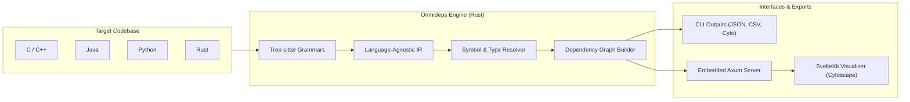

# Omnideps

[](https://www.rust-lang.org/)
[](https://svelte.dev/)
[](https://tree-sitter.github.io/)
[](LICENSE)
[]()
[]()

A high-performance, language-agnostic architectural dependency analyzer and visualizer based on **Tree-sitter**. Omnideps extracts structural and behavioral relationships across multiple programming languages (Rust, Java, Python, C, C++), translates concrete Abstract Syntax Trees (AST) into a unified Intermediate Representation (IR), resolves symbols and types, and produces interactive, queryable software architecture graphs.

Developed by **Christian Ferrario** as the core research and engineering artifact for his **Master's Degree Thesis in Computer Science** at the **University of Milano-Bicocca** (A.Y. 2024–2025).

---

## Key Features

- **Multi-Language AST Extraction:** Leverages official Tree-sitter grammars to parse Rust, Java, Python, C, and C++ source code with near-instantaneous parsing throughput.
- **Unified Intermediate Representation (IR):** Decouples language-specific syntax from dependency semantics by normalizing constructs (types, classes, functions, modules, traits, imports) into a common architectural schema.
- **Type & Symbol Resolution:** Performs intra-project reference resolution across translation units, distinguishing between structural dependencies (inheritance, composition) and behavioral dependencies (method calls, instantiations).
- **Single Standalone Executable:** Zero external runtime dependencies. The interactive SvelteKit web visualizer is pre-compiled and embedded directly inside the Rust binary using `rust-embed`.
- **Interactive Graph Visualizer:** Built-in local HTTP server powered by **Axum** and **Tokio** that automatically launches a Cytoscape.js canvas to inspect, filter, cluster, and traverse component graphs in real time.
- **Empirical Benchmarking Suite:** Automated ground-truth test harness to evaluate extraction accuracy, precision, recall, and false-positive rates against language edge cases.
- **Flexible Export Formats:** Outputs standard JSON graphs, Cytoscape-compatible structures, and aggregated CSV summary metrics.

---

## Architecture Overview



1. **Parser Layer:** Scans project directories and applies language-specific Tree-sitter parsers to generate concrete syntax trees.
2. **IR Normalization:** Maps language-specific constructs into generic architectural entities (`Component`, `Interface`, `Function`, `Module`) and relations (`Inherits`, `Implements`, `Calls`, `Imports`, `Instantiates`).
3. **Resolution Engine:** Resolves qualified and unqualified symbol references using lexical scoping, module paths, and type hierarchies.
4. **Server & Visualization Layer:** An embedded Axum web server serves the static SvelteKit UI from memory via `rust-embed`, establishing a zero-config visualization pipeline.

---

## Installation

### Download Standalone Binary (Recommended)
End users do **not** need Node.js, npm, or the Rust toolchain installed:

1. Download the latest pre-compiled binary for your operating system from the **[Releases](https://github.com/FerrarioChristian/omnideps/releases)** page.
2. Grant executable permissions (Linux / macOS):
   ```bash
   chmod +x omnideps
   sudo mv omnideps /usr/local/bin/
   ```
3. Run `omnideps --help` to verify the installation.

---

## CLI Usage & Commands

Omnideps follows modern CLI conventions with dedicated subcommands:

### 1. Analyze a Codebase
Extract the architectural dependency graph from a target directory or file:

```bash
omnideps analyze /path/to/target/project -o output_graph.json
```

**Common Flags:**
- `-o, --output <FILE>`: Save dependency graph in standard JSON (automatically creates Cytoscape format alongside).
- `-c, --csv <FILE>`: Export high-level metrics and relation counts to a CSV file.
- `--config <FILE>`: Provide a custom configuration file for language filters and parsing depth.
- `-d, --debug-refs`: Print verbose tracing for resolved and unresolved symbol references.

### 2. Interactive Web Visualizer
Start the embedded local server and launch the browser visualizer:

```bash
omnideps serve
```

This starts a lightweight HTTP server on `127.0.0.1:3000` (configurable via `--port <PORT>`) and automatically opens your default browser. You can trigger new analyses and inspect Cytoscape graphs directly within the UI.

### 3. Benchmarking Suite
Evaluate precision and recall against ground-truth benchmarks:

```bash
# Run a specific benchmark suite
omnideps benchmark run tests/benchmarks/benchmark-rust -o ./results

# Run all benchmarks and produce aggregated metrics (results.csv)
omnideps benchmark all -o ./results
```

### 4. Configuration Management
Generate a starter configuration file with customizable rules and parsing strategies:

```bash
omnideps config init
```
This produces an `omnideps.json` file in the current working directory.

### 5. Cytoscape Graph Converter
Convert an existing standard Omnideps JSON output into Cytoscape.js format:

```bash
omnideps export-cyto input.json cytoscape_graph.json
```

---

## Building from Source

To compile Omnideps from source, ensure you have **Rust** (stable toolchain) and **Node.js** (>= 18) installed.

1. **Clone the repository:**
   ```bash
   git clone https://github.com/FerrarioChristian/omnideps.git
   cd omnideps
   ```

2. **Build the SvelteKit Frontend:**
   The frontend build artifacts must be generated before building Rust so `rust-embed` can bundle them:
   ```bash
   cd visualizer-svelte
   npm install
   npm run build
   cd ..
   ```

3. **Build the Rust Binary:**
   ```bash
   cargo build --release
   ```
   The optimized executable will be located at `target/release/omnideps`.

4. **Run Test Suites:**
   ```bash
   cargo test
   ```

---

## Tech Stack

- **Core Engine:** Rust (2024 edition), `tokio`, `axum`, `clap`, `serde`, `rayon`.
- **Parsing:** `tree-sitter` with grammar bindings for C, C++, Java, Python, and Rust.
- **Embedded Web UI:** SvelteKit, Tailwind CSS, Cytoscape.js, `rust-embed`.
- **Packaging & CI/CD:** GitHub Actions multi-platform matrix build (Linux, macOS Apple Silicon / Intel, Windows).

---

## Academic Context & Attribution

This software was designed and developed as part of Christian Ferrario's Master's Degree Thesis:
- **Title:** *A Language Agnostic Framework for Dependency Extraction*
- **Institution:** Università degli Studi di Milano-Bicocca — Department of Informatics, Systems and Communication (DISCo)
- **Academic Year:** 2024–2025

The complete academic thesis dissertation is available in the companion repository [master-thesis](../master-thesis).

---

## License

This project is licensed under the [MIT License](LICENSE).
